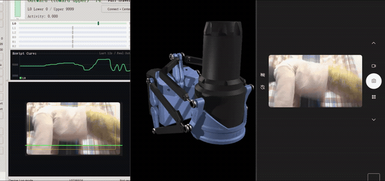
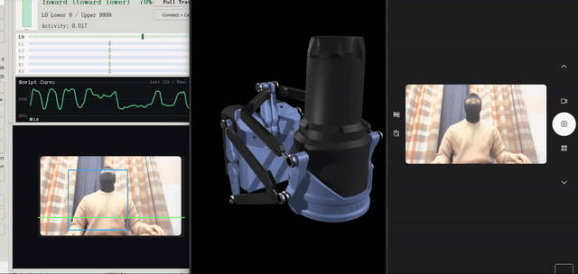
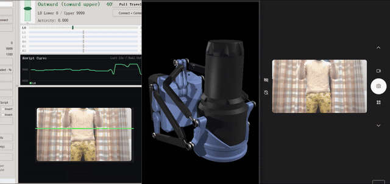
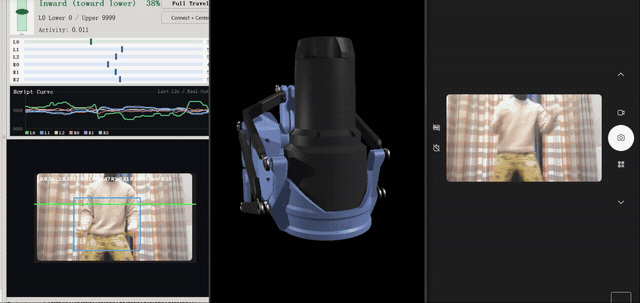
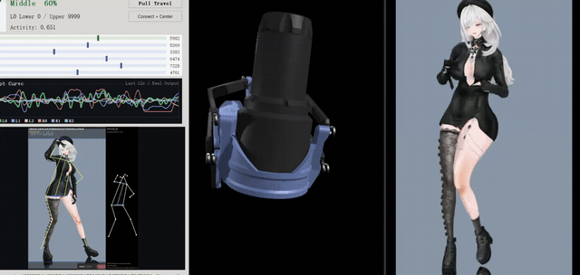
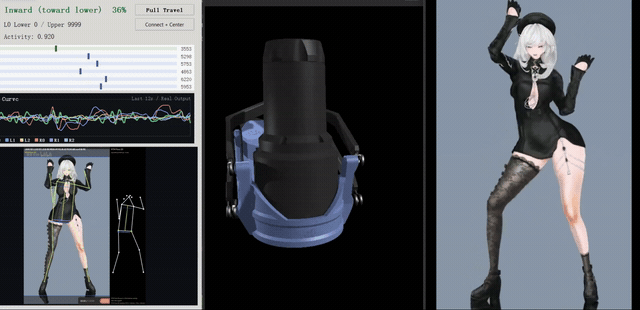

# SR6/OSR6 Realtime Screen TCode

## English

An open-source Windows tool that reads a selected screen region, converts visible motion into realtime TCode, and sends it to a device over USB or BLE. Preview the output without hardware, or record/export `.funscript` positions.

**Practical results on real hardware:** on 2026-11-12, the maintainer reported USB (USB-C) and BLE use, with useful results from dance analysis in L0/Six Axis and Hybrid Analysis in L0. See the [dated hardware-use report](docs/HARDWARE_TESTING.md) for the reported scope.

> **Adults only. This project is intended for adults. Minors are prohibited.**

### Download and source versions

**Latest release: [2.1.1](https://github.com/LexZeon/osr-screen-tcode/releases/tag/v2.1.1).**

- **[Windows portable ZIP](https://github.com/LexZeon/osr-screen-tcode/releases/download/v2.1.1/SR6-OSR6-Realtime-Screen-TCode-v2.1.1-Windows.zip):** extract the complete folder, then double-click **Start.cmd** or **SR6-OSR6-Realtime-Screen-TCode.exe**. Python is bundled; keep `_internal` beside the exe.
- **[Matching Source ZIP](https://github.com/LexZeon/osr-screen-tcode/releases/download/v2.1.1/SR6-OSR6-Realtime-Screen-TCode-v2.1.1-Source.zip)** or **[v2.1.1 source tag](https://github.com/LexZeon/osr-screen-tcode/tree/v2.1.1):** use Python 3.10+ and the source Start.cmd. [Startup guide](https://github.com/LexZeon/osr-screen-tcode/blob/2.0.0-beta/Start.md).

**Source version note:** the default `main` branch retains the older **1.1.2** program source. Use the **v2.1.1 tag/Source ZIP** for the latest release's matching source. Current documentation and ongoing source work are on [2.0.0-beta](https://github.com/LexZeon/osr-screen-tcode/tree/2.0.0-beta). Extract the complete Windows package before running it; the separate Start.cmd attachment requires that folder.

### Start in three steps

1. Open **Start.cmd**, select **Log only**, and inspect Output Monitor without sending device commands.
2. Choose an analysis mode and screen region. Use RTM Pose 2D for dance-oriented pose analysis or Hybrid Analysis for image motion; inspect Analysis Preview and the resulting curve.
3. Check saved travel limits, axis directions and a modest output range, then choose the intended USB serial/BLE connection and start device output. Use clear, well-lit material for Six Axis; otherwise begin with L0 Only.

### Main functions

- **RTM Pose 2D:** dance-oriented L0/Six Axis analysis, in-app model download, optional GPU acceleration and CPU fallback.
- **Hybrid Analysis:** image-motion analysis; **v2 is the default**.
- **Full/Half Travel:** uses confirmed image reciprocation to select full, half or quarter L0 travel, with limited rhythm adaptation.
- **Output Monitor and Show Preview:** display final live TCode after output travel, inversion, coupling, limits and speed handling. Recording/export to `.funscript` is also available; normalized script positions and final live TCode are distinct.
- **Output controls:** per-axis limits, travel scaling, presets, smoothing and saved preferences. **Analysis Preview** shows image evidence; the separate **Pose Preview Lab** is visual-only and does not drive a device.
- **Optional v2 models, off by default:** download/select ViTTrack or NeuFlow in the application. ViTTrack supports CPU; NeuFlow needs NVIDIA CUDA and does not support DirectML. Models and optional GPU runtimes are not bundled.
- Screen capture and analysis run locally; the application does not upload screen frames. [Every feature and its scope](https://github.com/LexZeon/osr-screen-tcode/blob/2.0.0-beta/docs/FEATURES.md).

### Scope

Practical results are reported for the scenarios above, not every device, firmware or video. Image scale/contact candidates do not measure true depth or establish physical contact. Robot joint mapping, inverse kinematics, collision detection and physical feedback remain unverified; the simulator displays commands rather than hardware feedback. The [hardware-use report](docs/HARDWARE_TESTING.md) is later user feedback, separate from the original automated release checks.

### Historical analysis demos

These retained **1.0/1.1.2-era demos are not new 2.1.1 benchmarks** or evidence of the current real-device test scope.

**Hybrid L0 / Six Axis — available since v1.0.0.** Recorded test hardware: Intel Ultra 9 CPU; GPU disabled/not used for this analysis.

**RTM Pose 2D — v1.1.2 demos.** Recorded hardware: Intel Ultra 9 CPU; the GPU demo enables NVIDIA GeForce RTX 4090 Laptop GPU acceleration, while the CPU demo has GPU acceleration off.

Dance footage in the RTM Pose demos: [Bilibili BV1UvtE6uEkD](https://www.bilibili.com/video/BV1UvtE6uEkD/). For infringement concerns, contact **lexzeonstudio@gmail.com** for removal.

### Documentation and contribution

[Startup](https://github.com/LexZeon/osr-screen-tcode/blob/2.0.0-beta/Start.md) · [Feature guide](https://github.com/LexZeon/osr-screen-tcode/blob/2.0.0-beta/docs/FEATURES.md) · [Architecture](https://github.com/LexZeon/osr-screen-tcode/blob/2.0.0-beta/docs/ARCHITECTURE.md) · [AI/developer handoff](https://github.com/LexZeon/osr-screen-tcode/blob/2.0.0-beta/AI_Prompting_Guide.md) · [2.1.1 release changes](https://github.com/LexZeon/osr-screen-tcode/blob/v2.1.1/docs/Release_2.1.1.md) · [Validation and recorded UI issue](https://github.com/LexZeon/osr-screen-tcode/blob/v2.1.1/docs/Validation_2.1.1.md).

Developed with AI assistance and iterated through real-device use, regression testing and community feedback. The independent Lab remains a developer preview. Historical validation records, tags and release packages are retained.

Use [usb-screen-stream](https://github.com/LexZeon/usb-screen-stream) to mirror a USB-connected phone/device screen to the PC, then select that window here for screen analysis.

Thanks to **DK**, **机械纪元**, and **“电话机”** for guidance, volunteer testing and suggestions. The project learned from public work including **FunGen**, **PoseFunscripter** and **nb-3d-simulator**. See [Contributing](CONTRIBUTING.md), [LICENSE](LICENSE), [third-party notices](https://github.com/LexZeon/osr-screen-tcode/blob/v2.1.1/THIRD_PARTY_NOTICES.md) and [open-source notice](https://github.com/LexZeon/osr-screen-tcode/blob/v2.1.1/OPEN_SOURCE_NOTICE.md).

Contact for suggestions, collaboration or corrections: **[lexzeonstudio@gmail.com](mailto:lexzeonstudio@gmail.com)**.

## 中文

这是一个开源 Windows 实时读屏输出工具：读取框选的屏幕区域，将画面运动转换为 TCode，通过 USB 或 BLE 发送给设备。也可以先不连接硬件预览，或者录制／导出 `.funscript` 位置脚本。

**实机已获得可应用效果：**维护者于 2026-11-12 反馈，使用过 USB（USB-C）与 BLE 连接，舞蹈识别的 L0／六轴、混合分析的 L0 均有可应用效果。具体范围见[实机使用记录](docs/HARDWARE_TESTING.md)。

> **成年人使用提示：本项目面向成年人使用，未成年禁止入内。**

### 下载与源码版本

**最新发布版：[2.1.1](https://github.com/LexZeon/osr-screen-tcode/releases/tag/v2.1.1)。**

- **[Windows 便携 ZIP](https://github.com/LexZeon/osr-screen-tcode/releases/download/v2.1.1/SR6-OSR6-Realtime-Screen-TCode-v2.1.1-Windows.zip)**：完整解压后，双击 **Start.cmd** 或 **SR6-OSR6-Realtime-Screen-TCode.exe**。自带 Python，保留 exe 旁边的 `_internal`。
- **[配套 Source ZIP](https://github.com/LexZeon/osr-screen-tcode/releases/download/v2.1.1/SR6-OSR6-Realtime-Screen-TCode-v2.1.1-Source.zip)** 或 **[v2.1.1 源码标签](https://github.com/LexZeon/osr-screen-tcode/tree/v2.1.1)**：准备 Python 3.10+，使用源码内的 Start.cmd；见[启动说明](https://github.com/LexZeon/osr-screen-tcode/blob/2.0.0-beta/Start.md)。

**源码版本说明：**默认 `main` 保留旧版 **1.1.2** 程序源码；获取最新发布版的配套源码，请用 **v2.1.1 标签／Source ZIP**。当前文档与后续源码工作位于 [2.0.0-beta](https://github.com/LexZeon/osr-screen-tcode/tree/2.0.0-beta)。运行前请完整解压 Windows 包，单独的 Start.cmd 附件需要配合完整目录。

### 三步上手

1. 打开 **Start.cmd**，先选择 **Log only**，在输出监视中检查结果，不发送设备指令。
2. 选择分析方式和屏幕区域。舞蹈姿态可选 RTM Pose 2D，画面运动可选混合分析；结合分析预览和输出曲线查看效果。
3. 核对保存的行程上下限、轴向与较小输出范围，再选择目标 USB 串口／BLE 连接并开始设备输出。六轴优先使用光线好、主体清晰的素材，否则先用 L0 Only。

### 主要功能

- **RTM Pose 2D**：面向舞蹈姿态的 L0／六轴分析，支持软件内下载模型、可选 GPU 加速及 CPU 回退。
- **混合分析**：分析画面运动，**默认使用 v2**。
- **全／半行程**：根据已确认的画面往复，选择全、半或 1/4 的 L0 行程，并有限度地适应节奏。
- **输出监视与显示预览**：展示经过行程、反向、联动、上下限和限速处理后的最终实时 TCode；也支持录制／导出 `.funscript`，归一化脚本位置与最终实时 TCode 有区别。
- **输出调节**：独立轴上下限、行程倍率、预设、平滑与设置保存。**分析预览**显示画面证据，独立 **Pose Preview Lab** 只做视觉预览，不驱动设备。
- **可选 v2 模型默认关闭**：软件内下载／选择 ViTTrack 或 NeuFlow。ViTTrack 可用 CPU；NeuFlow 要求 NVIDIA CUDA，不支持 DirectML。模型与可选 GPU 库不随包分发。
- 屏幕采集和分析在本机完成，软件不会上传画面。全部用途与边界见[逐项功能说明](https://github.com/LexZeon/osr-screen-tcode/blob/2.0.0-beta/docs/FEATURES.md)。

### 适用范围

实用效果对应上方已反馈场景，不代表每种设备、固件或视频都适用。画面尺度／接触候选不等于真实深度或实际接触；机械臂关节映射、逆运动学、碰撞检测和真实位置反馈仍未验证，模拟器显示指令而非硬件反馈。[实机使用记录](docs/HARDWARE_TESTING.md)属于后续使用反馈，与原自动化发布检查分开记录。

### 历史分析演示

以下保留的 **1.0／1.1.2 时期演示不是 2.1.1 新跑分**，也不代表本次实机测试范围。

**混合分析 L0／六轴——v1.0.0 起支持。** 原演示测试硬件：Intel Ultra 9 CPU，GPU 关闭／此分析未使用 GPU。

[L0 示例 1](screenshots/hybrid_analysis_l0_193515.gif) · [L0 示例 2](screenshots/hybrid_analysis_l0_193812.gif) · [L0 示例 3](screenshots/hybrid_analysis_l0_194652.gif) · [六轴示例](screenshots/hybrid_analysis_six_axis_195200.gif)

**RTM Pose 2D——v1.1.2 演示。** 原测试硬件：Intel Ultra 9 CPU；GPU 演示开启 NVIDIA GeForce RTX 4090 Laptop GPU 加速，CPU 演示关闭 GPU 加速。

[RTM Pose GPU 演示](screenshots/rtm_pose_2d_gpu_4090_laptop_204036.gif) · [RTM Pose CPU 演示](screenshots/rtm_pose_2d_cpu_intel_ultra_9_no_gpu_204419.gif)

RTM Pose 演示舞蹈素材来源：[Bilibili BV1UvtE6uEkD](https://www.bilibili.com/video/BV1UvtE6uEkD/)。如有侵权请联系 **lexzeonstudio@gmail.com** 删除。

### 文档与参与

[启动说明](https://github.com/LexZeon/osr-screen-tcode/blob/2.0.0-beta/Start.md) · [功能指南](https://github.com/LexZeon/osr-screen-tcode/blob/2.0.0-beta/docs/FEATURES.md) · [程序结构](https://github.com/LexZeon/osr-screen-tcode/blob/2.0.0-beta/docs/ARCHITECTURE.md) · [AI／开发者接手指南](https://github.com/LexZeon/osr-screen-tcode/blob/2.0.0-beta/AI_Prompting_Guide.md) · [2.1.1 发布改动](https://github.com/LexZeon/osr-screen-tcode/blob/v2.1.1/docs/Release_2.1.1.md) · [验证与已有界面问题记录](https://github.com/LexZeon/osr-screen-tcode/blob/v2.1.1/docs/Validation_2.1.1.md)。

本项目采用 AI 辅助开发，结合实机使用、回归测试和社区反馈持续改进。独立 Lab 仍是开发预览；历史验证记录、标签和发布包保留。

可使用 [usb-screen-stream](https://github.com/LexZeon/usb-screen-stream) 将 USB 连接的手机／设备画面投到电脑，再在本工具中框选该窗口分析。

感谢 **DK**、**机械纪元**和**“电话机”**提供指导、志愿测试与建议；本项目参考和学习了 **FunGen**、**PoseFunscripter**、**nb-3d-simulator** 等公开项目。见[贡献说明](CONTRIBUTING.md)、[许可证](LICENSE)、[第三方声明](https://github.com/LexZeon/osr-screen-tcode/blob/v2.1.1/THIRD_PARTY_NOTICES.md)和[开源说明](https://github.com/LexZeon/osr-screen-tcode/blob/v2.1.1/OPEN_SOURCE_NOTICE.md)。

建议、合作或纠正请联系：**[lexzeonstudio@gmail.com](mailto:lexzeonstudio@gmail.com)**。
